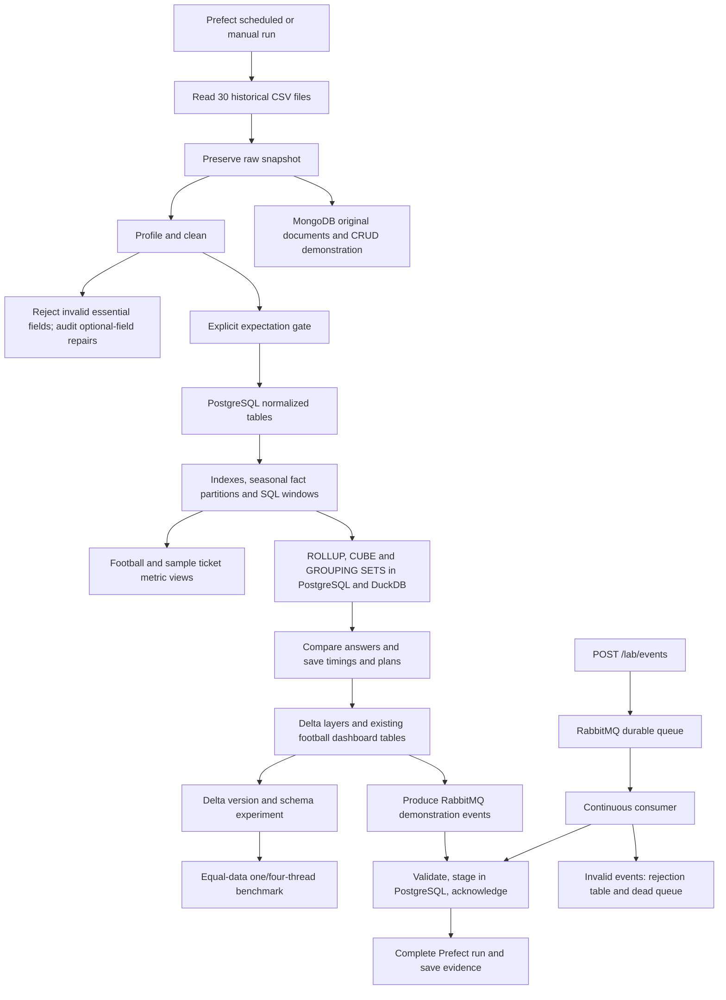
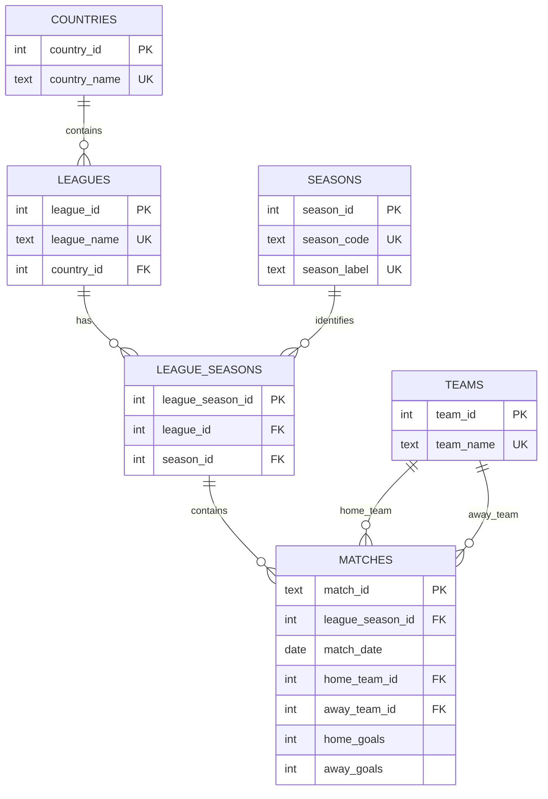

# PitchPulse 360 — the complete walkthrough

This guide describes the current executable football project. The original reports and README-original.md describe an older version and contain claims that should not be used as validation evidence.

## What you have built

Think of this project as a football information factory. It has a delivery desk, a checker, two kinds of cupboards, a calculator, a noticeboard, and a supervisor.

| Part | Baby words | Actual tool |
|---|---|---|
| Delivery desk | Collect the football files | Python CSV ingestion |
| Checker | Fix safe mistakes and record unsafe data | Pandas cleaning and profiling |
| Organized cupboard | Keep linked, structured match records | PostgreSQL |
| Flexible cupboard | Keep original records and documents with different shapes | MongoDB |
| Calculator | Answer summary questions quickly | PostgreSQL SQL and DuckDB |
| Parcel queue | Pass arriving events safely between programs | RabbitMQ |
| Supervisor | Run steps in order, retry failures, keep logs and schedule runs | Prefect |
| Noticeboard | Let a person explore the answers | Streamlit and Plotly |
| Other-program counter | Accept events and return information | FastAPI |
| Versioned storage | Preserve successive table versions | Delta Lake |

All experiments **1–15** now have implementations mapped in **ALL_15_EXPERIMENTS.md**. That document explains the four latest additions and identifies synthetic data and tool choices.

## Start and use the product

1. Start Docker Desktop and wait until its engine is running.
2. Double-click **Start.cmd** in the project folder. The first run downloads images and Python packages.
3. It starts the databases, broker and Prefect server, runs the batch, verifies it, and starts the dashboard, API, consumer and scheduler.
4. Open the dashboard at **http://127.0.0.1:8502**. Use the saved `results/` reports and API documentation to inspect the experiments.

Other screens:

| Screen | Address | What to inspect |
|---|---|---|
| Dashboard | http://127.0.0.1:8502 | Football charts and season analysis |
| API | http://127.0.0.1:8002/docs | GET information and POST a match event |
| Prefect | http://127.0.0.1:4201 | Flow runs, eleven task states, logs and scheduled deployment |
| RabbitMQ | http://127.0.0.1:15673 | Main queue and rejected-message queue |

RabbitMQ local demonstration login: `pitchpulse` / `pitchpulse_local_demo`. PostgreSQL uses the same local demonstration credentials and database `pitchpulse`, exposed on port 55432. MongoDB uses port 57017. These services are bound to localhost; this is a classroom/local product, not an internet-facing deployment.

PowerShell commands from the project folder:

```powershell
.\Start.ps1 -Action Start   # Build, start, run, verify and open services
.\Start.ps1 -Action Run     # Run and verify another full batch
.\Start.ps1 -Action Test    # Automated defect and integration tests
.\Start.ps1 -Action Stream  # Send a small real RabbitMQ demonstration
.\Start.ps1 -Action Status  # List this project's containers
.\Start.ps1 -Action Stop    # Stop this project; keep database volumes
```

The scripts stop on errors. They do not silently switch to fake databases or an in-memory broker. Docker volumes preserve the databases when containers stop. Keep the whole project folder together because it is mounted into the containers. The portable ZIP includes source, input CSVs and generated evidence; Docker volumes themselves are recreated by Start.cmd.

## The entire workflow



The batch is a full refresh of its match snapshot. Streaming is a separate arrival path into a staging table. A new streamed event does **not** automatically change historical standings: that would require a separate reconciliation process and official match identity/rules. Read recent staging events through GET `/lab/events`.

## Experiment 1 — explore and clean

**Question:** What do the input files contain, and can we trust each value?

`platform_lab/cleaning.py` reads five leagues across six seasons, preserving the original source filename and row number. There are 10,781 input matches. It uses cached files when available and downloads a missing file through the existing fetcher. If any league-season cannot be read, the full run fails rather than pretending the data is complete.

The profiler counts rows, columns, missing values and duplicates, identifies data types, and calculates numeric summaries. It creates a matches-per-league chart, a goals-per-match histogram, and a missing-values chart. `results/eda/report.html` displays before/after summaries and cleaning counts.

The cleaner:

- Trims spaces, standardizes repeated whitespace, and applies the explicit small team-name alias mapping in the code.
- Converts day-first date strings into actual dates.
- Converts score/card/shot text into nullable whole numbers.
- Rejects invalid dates, missing essential team/league/season identifiers, impossible scores, fractional scores, and fixtures where a team plays itself.
- Derives the result code from valid scores. For example, 2–1 means H; a mistaken A is repaired and counted.
- Deduplicates the same league/season/date/home/away fixture.
- Leaves missing optional measurements unknown instead of pretending they were zero.
- Audits and clears invalid optional measurements. One source match has 8 away shots and 9 away shots on target. Both suspect measurements become unknown; its valid 2–4 score remains. No replacement shot total is invented.
- Adds a stable match ID from the fixture identity, total goals, goal difference and points.

**Outliers:** An unusually large value is not always wrong. The program calculates the upper rule `Q3 + 1.5 × IQR` for total goals. Matches above it are written to `high_scoring_outliers.csv` for inspection. Valid results such as 8–2 stay in the dataset. Impossible measurement values are rejected or cleared according to whether they are essential or optional.

Files to show: `results/raw_snapshot.parquet`, `clean_matches.parquet`, `rejected_matches.csv`, `repaired_measurements.csv`, `high_scoring_outliers.csv`, and `eda/summary.json`.

## Experiment 2 — PostgreSQL schema, normalization and SQL

**Question:** How do we organize match records without copying the same descriptions everywhere?

The real PostgreSQL schema is created by `models/postgres_schema.sql` and populated by `platform_lab/postgres.py`.



**1NF:** Each cell contains a single value; no list of teams or repeated goal columns for multiple matches in one row.

**2NF:** Each table has a primary key and its other facts describe that key. A league-season pair has its own identity and a unique constraint.

**3NF:** Descriptions are separated along their dependencies. Country name belongs to a country, league country belongs to a league, and season label belongs to a season. Match rows reference those entities rather than storing repeated names and labels. Team names are unique within this supplied dataset; a worldwide production dataset would need authoritative club identifiers.

Calculated result codes, points and total goals are produced by a view, rather than stored redundantly in the normalized match table. The separate `analytics.match_facts` table is intentionally denormalized for reporting; we do not call that reporting table 3NF.

**Keys and constraints:** Primary keys identify records; foreign keys prevent references to nonexistent teams/editions; unique keys prevent duplicate fixtures; CHECK constraints reject impossible scores and shot relationships. Unknown optional measurements are permitted as SQL NULL.

**Joins:** `analytics.match_enriched` joins the six normalized tables into a human-readable match result.

**Window functions:**

- `DENSE_RANK` orders teams within each league-season by points, goal difference and goals scored. Tied values receive the same rank.
- `LAG` puts a team's previous recorded season's points beside its current season.
- `LEAD` puts its next recorded season's points beside the current one.
- `SUM(...) OVER` produces running points after each match, ordered by date and stable match ID.

These are illustrative performance rankings; they do not implement every official league tie-break, points deduction or qualification rule.

**Indexes:** Date, home-team/date and league-edition indexes provide lookup paths. The program saves a normal date-query plan and a deliberately forced sequential-scan plan. The latter is clearly labeled as a teaching comparison; indexes are not promised to be faster for every query.

**Partitions:** The analytical fact is split into six PostgreSQL season partitions. Plans for one selected season and all seasons show which partitions PostgreSQL reads. This is actual database partitioning, not just a folder name.

Files to show: `results/postgres/team_season_rank.csv`, `season_progression.csv`, `cumulative_points.csv`, `index_and_partition_plans.json`, and `summary.json`.

## Experiment 3 — CSV to clean PostgreSQL ETL

**Extract** means collect files. **Transform** means fix/standardize values and calculate useful fields. **Load** means place accepted records into PostgreSQL.

The loader uses PostgreSQL COPY to stage cleaned rows efficiently in a temporary table. It creates missing reference records, links their IDs, refreshes the normalized match table and analytical fact, and records a successful load in `football.etl_runs`.

The load is inside one database transaction. If any insert or constraint fails, the transaction rolls back, so readers do not see half of the new snapshot. An advisory database lock serializes warehouse replacement. The complete flow also uses a file lock to keep scheduled and manual batches from replacing reports simultaneously.

Rerunning replaces the snapshot rather than doubling match counts. Stable IDs, unique constraints and source-row provenance make the result traceable. Rejected essential rows go to CSV with reasons; optional-field repairs have a separate audit file.

## Experiment 5 — OLAP summaries

**OLAP** means looking at the same data from different summary angles. Our two dimensions are league and season, and the measures are match count and total goals.

`platform_lab/olap.py` runs these SQL forms in both PostgreSQL and DuckDB:

| Form | Baby words | What it produces |
|---|---|---|
| ROLLUP | Add up a hierarchy | League-season rows, each league's total, overall total |
| CUBE | Add every combination | League-season rows, league totals, season totals, overall total |
| GROUPING SETS | Choose exact totals | Explicitly requested detail, league, season and overall groups |

`GROUPING()` flags explain whether a blank dimension represents a subtotal. The program asserts that the two engines return the same answers and checks the grand totals against the cleaned dataset. DuckDB keeps its analytical table in `results/football.duckdb`.

Each query receives a warm-up and five timed executions. The median is saved, along with PostgreSQL JSON plans and DuckDB EXPLAIN ANALYZE output. Timings include the configured local connection paths and must not be presented as a universal database speed ranking. The three SQL forms return different levels of subtotal, so compare their work as well as their timing.

Files to show: `results/olap/rollup.csv`, `cube.csv`, `grouping_sets.csv`, `comparison.json`, and the six plan files.

## Experiment 7 — MongoDB CRUD and indexes

**Why another database?** PostgreSQL is useful for strict relationships. MongoDB is useful for keeping flexible documents, such as an original match record or a scout note whose nested fields vary.

`platform_lab/mongo.py` connects to a real MongoDB server and upserts the original CSV match rows into `pitchpulse.raw_matches`. Its source filename/row key prevents duplicate documents on reruns. This preserves the original suspect shot measurements as evidence, separate from the cleaned PostgreSQL copy.

The CRUD demonstration uses its own `scout_reports` collection:

1. **Create:** insert a scout report with a team, rating, nested notes and tags.
2. **Read:** retrieve only selected fields with a projection.
3. **Update:** change the rating, add a nested review flag and append a tag.
4. **Delete:** delete that demonstration document, then check that it is absent.

It also filters actual raw matches by league and season, projects team/score fields, creates compound indexes and saves an actual MongoDB query plan. A named index's existence alone is not proof that a query used it; inspect the saved winning plan for its access path.

Files to show: `results/mongo/crud_and_index_evidence.json` and MongoDB collections `raw_matches` / `scout_reports`.

## Experiment 10 — event-driven RabbitMQ pipeline

Imagine a match update as a parcel. The producer posts it, RabbitMQ keeps it in a queue, and a consumer opens it and places it into PostgreSQL staging.

`platform_lab/streaming.py` uses an actual RabbitMQ connection. Messages are persistent, queues are durable, and the producer requests broker confirmation. Validation enforces required fields, dates, goal ranges, different teams, and score/result agreement.

The consumer acknowledges a valid message only after the PostgreSQL transaction commits. If the database fails, it requeues the delivery for retry. The unique event ID prevents a redelivery from adding another staging row. This is at-least-once delivery with idempotent insertion, not an exactly-once broker guarantee.

Invalid messages are recorded with a reason and sent to a separate durable rejected queue before acknowledging the original. A crash during rejection handling may repeat rejection evidence; those records are an audit trail, not unique match facts.

Each full run publishes 20 valid demonstration events, repeats one event ID, and publishes one invalid payload. It verifies that only 20 unique valid events are staged, an invalid event is recorded, and a duplicate retry is ignored. These are replayed historical fixtures, **not live football feeds**.

The continuous consumer handles events arriving through `POST /lab/events`. Try an event in the API documentation:

```json
{
  "event_id": "class-demo-001",
  "demo_run": "classroom",
  "match_id": "example-fixture",
  "match_date": "2024-05-19",
  "home_team": "Arsenal",
  "away_team": "Chelsea",
  "home_goals": 2,
  "away_goals": 1,
  "result": "H"
}
```

POST returns 202 only after the broker confirms publication. GET `/lab/events` returns recent staging rows. Submitting the same event ID again does not add a second row. Invalid API requests return 422 before publication. The integration demo intentionally bypasses producer validation for its bad payload to exercise consumer-side rejection as well.

Files/tables to show: `results/streaming/demo.json`, PostgreSQL `staging.match_events` and `staging.rejected_events`, RabbitMQ `pitchpulse.match.events` and `pitchpulse.match.events.rejected`.

## Experiment 12 — scheduling and orchestration

The syllabus allows Airflow **or** Prefect. This version uses Prefect; the obsolete Airflow example is not an active DAG.

`platform_lab/flow.py` defines one flow with eleven dependent tasks: extract, clean/profile, expectation validation, PostgreSQL, metric views, MongoDB, OLAP, Delta/dashboard preparation, Delta feature demonstration, parallel benchmark, and streaming verification. Each task has explicit retries and logging. Cleaning retries once; database/source tasks retry twice. A permanent error still fails the task and flow after retries.

The scheduler service registers a deployment named `football-hourly` with a default 3,600-second interval and listens for scheduled runs. The `prefect` container runs the API, UI and background services together, sharing their local in-memory event bus and persistent metadata volume. The deployment limits itself to one concurrent run, and the shared file lock also serializes manual batches. This local single-server arrangement does not require a separate Redis event broker.

To change its interval in PowerShell:

```powershell
$env:PITCHPULSE_SCHEDULE_SECONDS='3600'
docker compose up -d --force-recreate scheduler
```

The interval is in seconds. The deployment name stays `football-hourly`; inspect its actual interval in Prefect if you change it. Stop the scheduler or pause its schedule in Prefect when you no longer want automatic runs. Scheduled work runs only while Docker/services are running. It is application scheduling, not a cloud service that runs with this computer off.

The verification command queries the real Prefect API for a completed flow and eleven completed tasks. A local JSON flag alone is not accepted as proof.

## Existing football features and their limits

- **Standings:** points, wins, draws, losses, goals and ranking charts. Tables are calculated from included results. Official deductions, league-specific tie-breaks and qualification exceptions are not fully modeled.
- **Player page:** hand-entered summary statistics and generated spatial positions. The heatmap smooths generated dots with Gaussian KDE; it is a visualization demonstration, not measured movement. The random seed is stable across runs.
- **Relegation page:** compares lower-table points using a simplified bottom-three rule. It should not be used as an official relegation decision system.
- **Head-to-head:** filters included domestic league matches involving two teams and summarizes outcomes. It does not include every cup/European/international meeting.
- **Records:** highest-scoring matches, champions and league comparisons within the six included seasons, not all football history.
- **Delta Lake:** stores raw, cleaned and standings snapshots with transaction history. Experiment 8 now separately demonstrates actual old-version reads and failed incompatible-schema writes; see ALL_15_EXPERIMENTS.md.
- **Serving API:** the original read endpoints remain; `/lab` adds actual event capture and staging inspection. Original role/financial masking examples remain demonstrations, not verified club finance data or production authentication.

## What counts as proof

Inspect `results/verification.json`, `last_run.json`, the supplied test log, saved query plans, actual service containers and Prefect run history. The launcher runs real integration checks and fails loudly if required services are absent.

There is a difference between **code exists**, **a service is running**, and **a behavior was tested**. The completion report records measured outcomes; do not reuse an old report's claims as proof of the new version.

## Source references

Implementation details were checked against [Psycopg COPY documentation](https://www.psycopg.org/psycopg3/docs/basic/copy/), [MongoDB CRUD documentation](https://www.mongodb.com/docs/languages/python/pymongo-driver/current/crud/), [MongoDB index documentation](https://www.mongodb.com/docs/languages/python/pymongo-driver/current/indexes/), and [Prefect deployment documentation](https://docs.prefect.io/v3/how-to-guides/deployments/create-deployments). Project results come from its own saved execution evidence.

